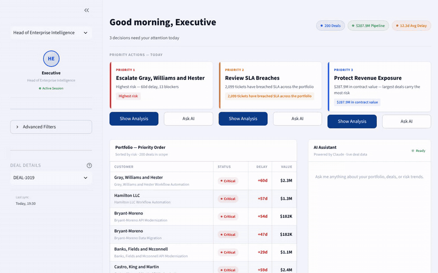
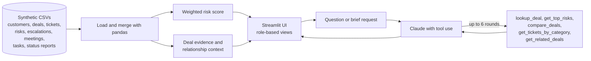

# AI BI Intelligence Platform

A Streamlit prototype that turns a portfolio of enterprise implementation projects into a decision-support experience: a ranked risk view, evidence behind each deal, and an AI analyst that answers leadership questions and drafts executive briefs.

> **Status:** proof of concept built on synthetic data. It is not a production system and has not been evaluated with real users.



*Recorded without an AI key, so it shows the dashboards and role views. The AI analyst and brief generator need an Anthropic key.*

## The problem

Leaders who oversee many implementation projects usually get static dashboards. Answering "which deals are most at risk, why, and who should act?" means opening several reports and asking an analyst to pull the numbers. This prototype tests whether one interface can show the same portfolio data, put the supporting evidence next to each score, and answer follow-up questions in plain language.

## What it does

- **Role-based views** for three leader personas: a head of enterprise intelligence, an implementations lead, and a revenue leader. Each sees different headline metrics and suggested decisions.
- **Portfolio risk ranking.** Every deal gets a 0-100 risk score from open blockers, estimated delay, ticket volume, escalations and logged risks.
- **Evidence panel.** For a selected deal, shows the customer, tickets, risks, escalations, meeting notes and status reports behind its score.
- **AI analyst chat.** Claude answers questions about the portfolio and can call tools to look up a deal, rank top risks, compare two deals, find open tickets by category, and find related deals (same customer, same project manager, or same issue pattern).
- **Executive briefs.** One click drafts a three-paragraph brief for a deal (situation, risk, action with owners), written for the selected role.
- **Works without an API key.** Dashboards and evidence still load; only the AI features show a configuration message.

## How it works



**Risk score.** A hand-weighted formula, scaled so the riskiest deal in the portfolio scores 100:

| Signal | Multiplier | Weight |
|---|---|---|
| Open blockers | 5 | 25% |
| Estimated delay (days) | 2 | 20% |
| Ticket count | 1 | 20% |
| Escalation count | 8 | 20% |
| Logged risks | 6 | 15% |

**AI layer.** `claude-sonnet-4-6` with a tool-use loop capped at 6 rounds. The portfolio snapshot and the focus deal's evidence are sent as cacheable context, and the system prompt asks the model to cite the data behind each answer.

## Data

Nine CSV files under `data/` with synthetic customers, deals, tickets, risks, escalations, meeting notes, tasks and status reports (about 12,750 rows in total). No real customer, employee or company data is included.

## Run it locally

```bash
pip install -r requirements.txt
streamlit run streamlit_app.py
```

To enable the AI features, set `ANTHROPIC_API_KEY` in a local `.env` file, or in `.streamlit/secrets.toml` (see `secrets.toml.example`). Never commit real keys.

On Streamlit Cloud, set the main file to `streamlit_app.py` and add `ANTHROPIC_API_KEY` under Settings, then Secrets.

## Design decisions

- **Evidence next to every score.** A number alone invites distrust, so each risk score sits beside the tickets, risks and escalations behind it.
- **Tools instead of one big prompt.** The model fetches only the deals it needs, which keeps context small and makes its answers traceable to specific records.
- **Transparent scoring over a model.** A weighted formula can be read, argued with and adjusted by the people who own the process, which matters more at this stage than predictive accuracy.
- **Runs without a key.** The core experience should not depend on an external API.

## Known limitations

- The risk weights are judgment calls, not fitted to outcomes. They have not been validated against real project results.
- The AI analyst has not been evaluated. There is no test set measuring answer accuracy, tool-selection correctness or hallucination rate.
- The tool functions read local CSVs. There is no authentication, row-level permission model or source lineage.
- Role personas change the view and the prompt, not the data a user is allowed to see.
- Scores update only when the CSVs change; there is no live data connection.

## What I would do next with real users

1. Replace the CSVs with a read-only connection to the source systems, with permissions mirrored from them.
2. Build a labelled set of 40-50 leadership questions with known answers, and track accuracy, citation correctness and tool-choice errors.
3. Compare the risk ranking against which projects actually slipped, and tune the weights from that.
4. Pilot with one team, and measure how often the tool answers a question that would otherwise need an analyst request.
5. Review data permissions, model governance and cost before widening access.

## Repository layout

```text
streamlit_app.py          Streamlit Cloud entry point
frontend/combined_app.py  The application
data/                     Synthetic CSV data
scripts/                  Data preparation helpers
graph/                    Early knowledge-graph experiments (not used by the app)
notebooks/                RAG experiments
```

## Tech stack

Python, Streamlit, pandas, the Anthropic API (Claude), python-dotenv.
